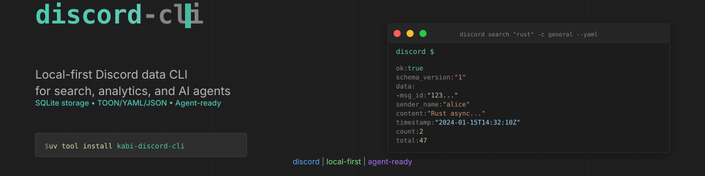
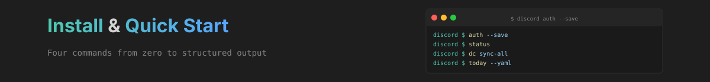
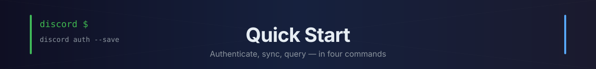
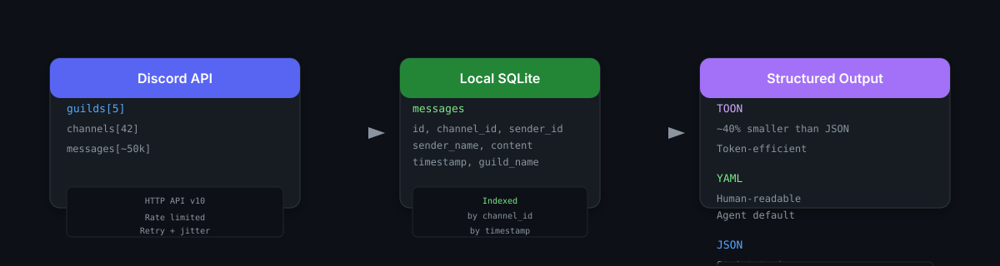
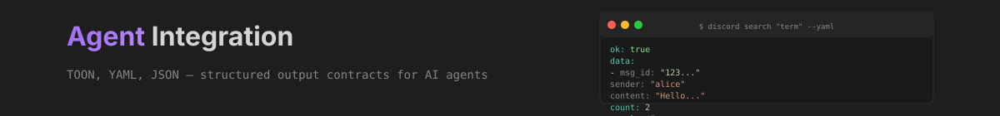
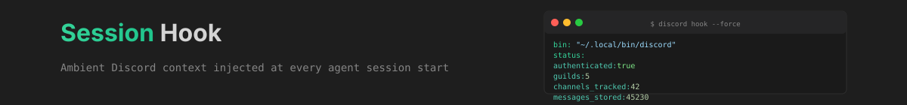

<p align="center">
  
</p>

<p align="center">
  

[](https://github.com/ishan-parihar/discord-cli/actions/workflows/ci.yml)
  
  
  
  
</p>

---

**Local-first Discord CLI** that syncs messages to SQLite for fast search, analytics, and AI agent integration — with structured **TOON / YAML / JSON** output.

> `discord-cli` uses the Discord HTTP API with a **user token** from your local session. It is meant for accounts you control, on machines you control.

---

<p align="center">
  
</p>

## Installation

```bash
# Recommended: uv tool (isolated, user-scoped, ~/.local/bin)

<!-- T2I HERO SPEC — Subject: a local-first Discord data CLI — Discord server channels feeding messages, search, and analytics into a local cache with agent-friendly JSON output; guild icons as orbiting nodes. Composition: server channels → cache vault → agent query. Palette: discord blurple #5865f2 → deep slate → cache emerald #34d399. Style: dark flat vector, channel-strip motif, no text. 16:9. -->
uv tool install kabi-discord-cli

# Alternative: pipx
pipx install kabi-discord-cli

# From source (development)
git clone https://github.com/jackwener/discord-cli.git
cd discord-cli && uv sync --extra dev
```

<details>
<summary><b>Fresh-install verification</b></summary>

```bash
# After install, verify it works
discord --version
# discord, version 0.2.8

# No auth yet — shows ambient context (content-first default)
discord
# bin: "~/.local/bin/discord"
# description: "Discord CLI for local-first sync, search, export, and agent-friendly retrieval"
# status: { authenticated: false, ... }
```
</details>

<p align="center">
  
</p>

## Quick Start

Four commands from zero to structured output:

```bash
# 1. Extract & save token from your local Discord/browser session
discord auth --save

# 2. Verify auth works (structured output for agents)
discord status --yaml

# 3. Bootstrap local storage (discovers & syncs all channels)
discord dc sync-all -n 500

# 4. Query with structured output
discord today --yaml
```

<details>
<summary><b>Content-first default</b> — run <code>discord</code> with no args to see live state</summary>

```bash
discord
# bin: "~/.local/bin/discord"
# description: "Discord CLI for local-first sync, search, export, and agent-friendly retrieval"
# status:
#   authenticated: true
#   user: "alice#1234"
#   guilds: 5
#   channels_tracked: 42
#   messages_stored: 45230
# recent:
#   - channel: "#general"
#     sender: "alice"
#     content: "Hello team!"
#     timestamp: "2024-01-15T10:30:00Z"
# help:
#   - "Run 'discord dc guilds --yaml' to list servers"
#   - "Run 'discord today --yaml' to see today's messages"
#   - "Run 'discord dc sync-all' to sync all channels"
```
</details>

---

<p align="center">
  
</p>

## How It Works

```
Discord API (HTTP v10)  ──sync──►  Local SQLite (FTS5)  ──query──►  Structured Output
     │                            │                           │
     ▼                            ▼                           ▼
• User token              • Incremental sync           • ok: true / data: [...]
• Rate limited            • FTS5 full-text search      • count / total / help
• Pagination              • Channel/guild metadata     • TOON / YAML / JSON
```

---

<p align="center">
  
</p>

## Agent Integration (AXI-Compliant)

Built for AI agents with **three structured output formats**:

| Format | Flag | Best For |
|--------|------|----------|
| **TOON** | `--toon` | Token-efficient (~40% smaller than JSON), native agent parsing |
| **YAML** | `--yaml` | Human-readable, agent default (non-TTY auto-selects) |
| **JSON** | `--json` | Strict typing, machine parsing |

### Envelope Schema

Every successful response uses a consistent envelope:

```yaml
ok: true
schema_version: "1"
data: [...]              # payload (list or object)
count: 2                 # items in this response
total: 47                # total available (may exceed count due to limits)
help:                    # contextual next-step hints
  - "Run 'discord recent -c general' to see recent messages"
  - "Run 'discord export general -f json -o out.json' to export"
command: "search"
```

### Structured Errors (stdout, never stderr)

```yaml
ok: false
schema_version: "1"
error:
  code: guild_not_found
  message: Guild 'My Server' not found
  details:
    searched: "My Server"
help:
  - "Run 'discord dc guilds --yaml' to list available servers"
```

### Agent-Friendly Flags

| Flag | Purpose |
|------|---------|
| `--fields id,name,topic` | Select only needed fields (reduces tokens) |
| `--full` | Disable content truncation (default: 200–300 chars) |
| `OUTPUT=toon` | Set default format via env var |

---

## Commands

### Auth & Account

| Command | Description |
|---------|-------------|
| `auth [--save]` | Extract token from local Discord/browser session |
| `status [--yaml\|--json\|--toon]` | Check token validity (exit 0 = valid) |
| `whoami [--yaml]` | Show current Discord profile |

### Discord API (`discord dc ...`)

| Command | Description |
|---------|-------------|
| `dc guilds [--yaml]` | List joined guilds (minimal: `id`, `name`, `owner`) |
| `dc channels GUILD [--yaml]` | List text channels in a guild |
| `dc history CHANNEL [-n 1000] [--yaml]` | Fetch message history |
| `dc sync CHANNEL [-n 5000] [--yaml]` | Incremental sync (new messages only) |
| `dc sync-all [-n 5000]` | Discover & sync all accessible channels |
| `dc tail CHANNEL [--once]` | Poll & follow new messages like `tail -f` |
| `dc search GUILD KEYWORD [-c CHANNEL] [--yaml]` | Discord native search |
| `dc members GUILD [--max 50] [--yaml]` | List guild members |
| `dc info GUILD [--yaml]` | Show detailed guild info |

### Local Query (SQLite)

| Command | Description |
|---------|-------------|
| `search KEYWORD [-c CHANNEL] [-n 50] [--yaml]` | Search stored messages |
| `recent [-c CHANNEL] [--hours N] [-n 50] [--yaml]` | Newest stored messages |
| `stats [--yaml]` | Message stats per channel |
| `today [-c CHANNEL] [--yaml]` | Today's messages grouped by channel |
| `top [-c CHANNEL] [--hours N] [-n 20] [--yaml]` | Top senders |
| `timeline [-c CHANNEL] [--hours N] [--by day\|hour] [--yaml]` | Activity timeline |

### Data Management

| Command | Description |
|---------|-------------|
| `export CHANNEL [-f text\|json\|yaml\|toon] [-o FILE] [--hours N]` | Export stored messages |
| `purge CHANNEL [-y]` | Delete stored messages for a channel |

---

<p align="center">
  
</p>

## Session Hook (Ambient Context)

Inject live Discord state at agent startup:

```bash
# Install hooks for all supported agents
discord hook --force
```

This adds a `SessionStart` hook to:

- **Claude Code** → `~/.claude/settings.json`
- **Codex** → `~/.codex/hooks.json`
- **OpenCode** → `~/.config/opencode/plugins/discord-cli/manifest.json`

Agents receive ambient context on every session start:

```yaml
bin: "~/.local/bin/discord"
description: "Discord CLI for local-first sync, search, export, and agent-friendly retrieval"
status:
  authenticated: true
  user: "alice#1234"
  guilds: 5
  channels_tracked: 42
  messages_stored: 45230
recent:
  - channel: "#general"
    sender: "alice"
    content: "Hello team!"
    timestamp: "2024-01-15T10:30:00Z"
```

---

## Agent Tips

```bash
# Prefer --yaml for structured output (non-TTY auto-selects)
discord search "rust" -c general --yaml

# Limit results to stay token-efficient
discord recent -n 20 --yaml

# Export large datasets to file
discord export general -f json -o out.json

# Select only needed fields
discord dc guilds --fields id,name,owner --yaml

# Show full message content (no truncation)
discord search "term" --full --yaml

# Use env var for consistent output mode
OUTPUT=toon discord search "term"
```

---

## Architecture

- **Local-first**: SQLite at `~/Library/Application Support/discord-cli/messages.db` (macOS) or `~/.local/share/discord-cli/messages.db` (Linux)
- **Incremental sync**: `dc sync` only fetches messages after last stored ID
- **Full-text search**: FTS5 indexes for instant local search
- **Rate limit handling**: Automatic retry with exponential backoff + jitter
- **Schema**: [SCHEMA.md](./SCHEMA.md) — structured output contract

---

## Safety & Limits

> ⚠️ **Important**: `discord-cli` reads a **user token** from your local Discord/browser session. Discord may restrict or suspend accounts that automate user-token traffic. Use only on your own account and only if you understand the risk.

- No bot token required (uses user token from local session)
- Messages stored locally in SQLite — never uploaded
- Rate limits handled automatically with retry + jitter
- Upgrade regularly: `uv tool upgrade kabi-discord-cli`

**Read-only.** `discord-cli` is a read/tail/search tool — it has no mutation commands (no send, no react, no delete). It authenticates, lists servers/channels/members, and fetches/history/syncs/search queries messages. Sending and managing content is out of scope.

---

## Development

```bash
uv sync --extra dev
uv run ruff check .
uv run python -m pytest
uv build
```

---

## License

Apache-2.0

---

## ☕ Support & Sponsorship

If you find this project useful, consider supporting ongoing development:

[](https://github.com/sponsors/ishan-parihar)
[](https://rzp.io/rzp/ishan-parihar)

Your support funds new features, releases, and infrastructure for the whole ecosystem.
